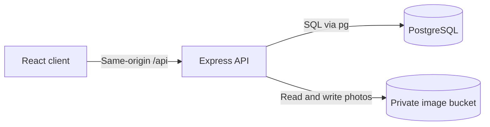

# Architecture

Romel Hair Salon uses a React single-page application and an Express API. PostgreSQL owns the operational records. Service photos live in object storage, with their keys stored on the corresponding service rows.

## Runtime

| Layer | Implementation |
| --- | --- |
| Browser | React Router renders customer and employee workspaces. Axios sends requests to relative API paths. A saved theme preference applies before React renders. |
| API | Express validates input with Zod, authenticates the session cookie, checks permissions, and calls the appropriate module. Known API paths return JSON errors, including a request ID. |
| Database | Versioned SQL migrations define the salon schema, constraints, and triggers. A connection pool serves runtime queries. Release tooling uses a direct connection for migration locks. |
| Storage | Sharp validates and normalizes service photos. The server writes each replacement under a fresh key and updates the service record before removing the old object. |

In development, Vite proxies API calls to the local Express process. A local production build can serve both the client and API through Express. On Vercel, the client is static and the API runs through a Node function that reuses its database pool. [Vercel entry point](api/salon.js) · [Deployment guide](docs/deployment.md)

## Identity and access

Passwords use bcrypt. A signed token in an HTTP-only cookie identifies a server-side session. The API checks that the session is active and that the account has the required permission. Browser writes also require a trusted origin and application header. Customers can access their own records, and stylists and beauticians can access their assigned appointments and personal earnings. Managers control accounts and salon policies. [Authentication module](server/src/modules/auth) · [Request middleware](server/src/middleware/auth.js)

## Operational data

| Workflow | How the system preserves consistency |
| --- | --- |
| Booking | Slot queries combine opening hours, closures, service duration, staff eligibility, availability, and existing bookings. The reservation transaction rechecks the slot. A database exclusion constraint prevents overlapping active bookings for the same employee. |
| Cash checkout | The API calculates totals from catalog or booking prices and the salon’s tax and discount settings. One transaction records the sale, payment, item snapshots, inventory movements, and eligible commissions. A retry with the same checkout key returns the original receipt. |
| Stock and refunds | Retail sales and service recipes produce stock movements. A manager can record a full refund and choose whether to return retail units to stock. Refunds of commissions already included in payroll generate adjustments for a later period. |
| Payroll | A draft gathers eligible earnings and unapplied adjustments. Approval rechecks amounts and associates each included entry with the run. Recording cash payout advances the approved run to paid. |
| Reporting | Sales and refunds contribute to totals on their respective Manila business dates. The same records feed the dashboard, sales reports, and printable or downloadable summaries. |

Money is recorded in integer centavos. Historical sale lines retain item descriptions and unit prices. Activity logs associate important changes with the acting account. [Operational modules](server/src/modules/operations) · [Finance module](server/src/modules/finance) · [SQL migrations](server/migrations)

## Local data and verification

Local setup creates separate development, demo, and test databases in a workspace PostgreSQL cluster. Development photos use a Git-ignored local directory when object storage is unconfigured. Production requires object storage credentials for uploads. The integration suite exercises real PostgreSQL transactions and uses a local S3-compatible test endpoint for image upload and replacement. [Test suite](server/tests) · [Local setup](README.md#run-locally)
