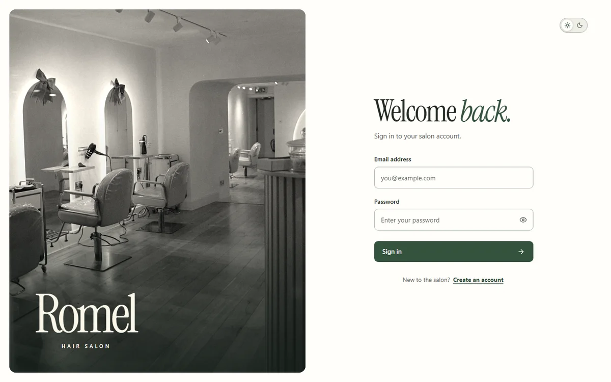

# Romel Hair Salon

A full-stack salon management app that follows a visit from booking to payroll. Customers reserve a time with an eligible stylist. At checkout, the cashier can turn the completed appointment into a receipt, and the same transaction records stock usage and the stylist’s commission.



## A visit through the app

| Who | What they can do |
| --- | --- |
| Customer | Choose a service, stylist, and available time. Reschedule or cancel a booking and view past services. |
| Stylist or beautician | See assigned appointments, update their status, and review personal earnings. |
| Receptionist or cashier | Schedule visits, look up customers, ring up services and retail products, and print cash receipts. |
| Manager | Set prices and hours, upload service photos, adjust stock, review sales and refunds, and approve payroll. |

## Engineering highlights

- **Concurrent bookings.** PostgreSQL enforces non-overlapping appointments for each stylist. Two customers can select the same time, but only one reservation can commit.
- **Retry-safe checkout.** A checkout key identifies a sale across retries. The API writes the payment, stock movements, and commission entries in one transaction so a retry cannot charge twice or deduct stock twice.
- **Private service photos.** The server validates JPEG, PNG, and WebP uploads, resizes them, and stores WebP images in a private bucket. PostgreSQL tracks the object key. The browser retrieves the photo through the authenticated API.
- **Accessible presentation.** The responsive React interface includes a persistent sun/moon theme switch and respects reduced-motion preferences. Receipts print separately from the workspace.

Built with React, Vite, React Router, Express, and PostgreSQL. The deployment configuration targets Vercel, Neon Postgres, and Neon Object Storage. Checkout currently supports cash.

## Run locally

Install Node.js 22.18+ in the 22.x series or Node.js 24.x, plus PostgreSQL 18. On Windows, local setup looks in `C:\Program Files\PostgreSQL\18\bin`. Set `PG_BIN` to your PostgreSQL binary directory for another installation.

```sh
npm ci
npm --prefix server ci
npm run db:local:setup
npm run auth:local:setup
npm run dev:all
```

Open [the local app](http://localhost:5173). The first manager’s credentials are generated in the Git-ignored `.local-runtime/manager-account.json`. To try a booking, use the manager account to create a stylist and an active service with a duration, assign the stylist to the service, then register a customer account.

## Verify

```sh
npm run lint
npm test
npm run test:db
npm run build
```

The integration suite uses a separate local PostgreSQL database. It exercises booking conflicts, checkout retries, refunds, payroll, and image replacement. After building, stop the development servers and run `npm start` to open the [production build locally](http://localhost:3000).

## Documentation

- [Architecture](ARCHITECTURE.md) covers request handling, access control, and transaction boundaries.
- [Deployment](docs/deployment.md) covers Vercel configuration, Neon storage, database migrations, and the first production manager.
