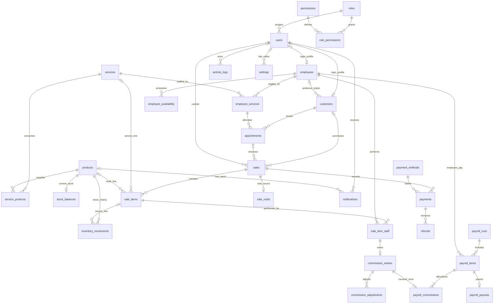

# PostgreSQL Model and Data Dictionary

## Phase 2 implementation

The application schema is `salon`; migration history is in `public.schema_migrations`. Local PostgreSQL 18.3 runs on loopback port 5433 using the installed binaries. An isolated workspace cluster contains `romel_salon_dev`, `romel_salon_demo`, and `romel_salon_test`, owned by the dedicated non-superuser `romel_app` role. Bootstrap administration uses a separate generated local role.

This phase creates storage and integrity rules. Business APIs, authentication, service consumption timing, final prices/taxes, commission/payroll rules, and payment providers remain future work. Synthetic historical cash fixtures are not actual payment processing.

## Entity relationships

Supporting tables not connected in the diagram: `database_identity`, `business_hours`, `closures`, `seed_runs`, and migration metadata. Sale/appointment relations allow a replacement after a void; a partial unique index permits only one non-void sale per appointment.

## Data conventions

| Type | Storage and interpretation |
| --- | --- |
| Record identity | UUID primary keys, generated normally with `gen_random_uuid()`; fixture UUIDs are stable |
| Money | `bigint` centavos, e.g. 35000 = PHP 350.00; no floating-point currency columns |
| Stock / quantities | `numeric(14,3)` in each product's explicit stock unit; unit conversion rules remain TBD |
| Instants | `timestamptz`; APIs must send offsets/UTC and report by `Asia/Manila` business boundaries |
| Payroll/closure dates | `date`; payroll periods are start-inclusive/end-exclusive |
| Business hours | Local `time` plus weekday 0=Sunday, 6=Saturday; definition state indicates unset/demo/confirmed |
| Undefined policy | SQL `NULL` in optional numeric/snapshot fields; JSON `null` in `settings.value` with `definition_state=placeholder` |
| Precision at the API | `pg` returns big integers/decimals as strings; retain them or use exact arithmetic rather than blindly converting to JavaScript Number |
| Deactivation | Referenced master records retain their identity/history; use `is_active=false` instead of deleting them |

## Table dictionary

| Table | Main columns / keys | Meaning and constraints |
| --- | --- | --- |
| `database_identity` | Singleton PK; application, environment, database_name | Defaults to production identity; fixture tools require matching local name and demo/test marker |
| `roles` | UUID PK; unique code | Manager, cashier, stylist, beautician, customer |
| `permissions` | UUID PK; unique code, description | Candidate capabilities; no default role grants |
| `role_permissions` | Composite PK role_id + permission_id; both FKs | Empty until the proposed permission policy is agreed |
| `users` | UUID PK; role FK; unique normalized email; password_hash | Bcrypt fixture hashes, active/demo flags, token_version reserved for Phase 3 |
| `employees` | UUID PK; unique nullable user FK; unique employee_code | Job kind, active flag; base pay and commission policy nullable |
| `customers` | UUID PK; unique nullable user FK; preferred employee FK | Registered or walk-in profile, contact details, preferences; customer records need not have accounts |
| `services` | UUID PK; unique code; price_cents, duration_minutes | Nullable definitions; demo prices/durations explicitly flagged |
| `employee_services` | Composite PK employee_id + service_id | Staff-service eligibility; appointments reference this pair |
| `business_hours` | Weekday PK; opening/closing times, closed flag | Placeholder rows initially have no times; seeded sample hours are marked demo |
| `closures` | UUID PK; unique closed_on, reason, creator FK | Dated salon closures for later availability logic |
| `employee_availability` | UUID PK; employee FK; start/end instants | Available/unavailable intervals; end must follow start |
| `settings` | Key PK; JSON value; definition_state; editor FK | Confirmed project currency/timezone; financial/booking policies remain JSON null |
| `appointments` | UUID PK; unique booking_reference; customer and staff-service FKs | Half-open time range, status/source, service name/price/duration snapshots |
| `products` | UUID PK; unique SKU; stock_unit, minimum_stock | Optional retail price; demo/retail/active flags |
| `service_products` | Composite PK service_id + product_id; quantity, definition_state | Consumption mapping; placeholder quantity is NULL, not an assumed deduction |
| `stock_balances` | Product PK/FK; quantity, updated_at | Nonnegative balance changed through inventory movement trigger |
| `inventory_movements` | UUID PK; product/actor FKs; optional sale-item/reversal FKs | Signed quantity, reason/time/source; unique product+source_type+source_reference prevents retries |
| `sales` | UUID PK; unique idempotency_key/receipt_number; customer/appointment/cashier FKs | Centavo totals and policy snapshots; paid records require defined totals/receipt; appointment/customer must match |
| `sale_items` | UUID PK; sale FK; exactly one service/product FK | Snapshot description/price/consumption; decimal quantity; rounded centavo line total |
| `sale_item_staff` | Composite PK sale_item_id + employee_id | Attribution and optional commission policy snapshot |
| `payment_methods` | Code PK; label; enabled | Cash, GCash, Maya, card; database constraint keeps all disabled until explicit later migration |
| `payments` | UUID PK; sale/method/actor FKs; unique idempotency key | Amount/tender/change, reference, status and demo flag; no provider/card credentials |
| `refunds` | UUID PK; payment+sale composite FK; unique idempotency key | Positive amount, reason and approver; payment must belong to the same sale |
| `sale_voids` | Sale PK/FK; reason, approver, timestamp | Preserve original sale rather than deleting it |
| `commission_entries` | UUID PK; unique sale-item+employee pair | Amount/policy NULL while pending_definition; FK requires actual staff attribution |
| `commission_adjustments` | UUID PK; commission/approver FKs | Signed amount change and explanation for future reversals |
| `payroll_runs` | UUID PK; unique start/end dates | Draft/approved/paid/voided state; approval requires policy, approver, timestamp |
| `payroll_items` | UUID PK; unique run+employee | Nullable base/commission/adjustment/net inputs; defined net must equal defined components |
| `payroll_commissions` | Item+commission PK; unique commission_id | Earning can be included once; trigger verifies employee ownership |
| `payroll_payouts` | UUID PK; unique payroll-item FK | Positive amount, recorder, paid timestamp, reference; workflow remains unimplemented |
| `notifications` | UUID PK; user/product FKs; unique recipient+dedupe_key | Read/resolved timestamps; low-stock fixture only |
| `activity_logs` | UUID PK; nullable actor FK; entity/action/reason/details/time | Append-only business history storage; future callers must scrub secrets |
| `seed_runs` | Seed key PK; reference_date, checksum | Tracks one repeatable fixture version and detects edited seed source |
| `public.schema_migrations` | Version PK; filename, checksum, applied_at | Applied SQL history; edited/missing applied versions are refused |

## Database integrity and concurrency

- An exclusion constraint combines employee equality and overlapping `tstzrange(...,'[)')` intervals. Pending, confirmed, in-progress, and completed records cannot overlap for a staff member; cancelled/no-show rows release their interval. Back-to-back intervals are valid. Status transition policies and capacity beyond one assigned staff member remain future decisions. [PostgreSQL range constraints](https://www.postgresql.org/docs/18/rangetypes.html)
- `btree_gist` supports the composite exclusion and is a trusted extension available to database owners with CREATE privileges. [PostgreSQL extension documentation](https://www.postgresql.org/docs/18/btree-gist.html)
- A successful inventory movement insert updates its balance in the same transaction. Row updates serialize concurrent deductions; a negative result fails the whole statement. Posting after INSERT also prevents `ON CONFLICT DO NOTHING` retries from deducting twice.
- Movement/log UPDATE and DELETE are blocked. Stock adjustments/reversals add new movement rows. Direct balance mutations and edits to finalized sale item snapshots are blocked.
- Migration runners use a session advisory lock plus one transaction per file. Seeds/resets use the same lock namespace transactionally. Failed files roll back schema changes and their history entry together. [PostgreSQL advisory locks](https://www.postgresql.org/docs/18/functions-admin.html#FUNCTIONS-ADVISORY-LOCKS)
- Fixtures/reset require non-production execution, a loopback URL, an exact dedicated database name, and a matching database identity/current database. Reset additionally requires the exact confirmation name. URL query parameters cannot override the selected host/user/database.

These constraints do not implement business checkout: cross-table sales/payment reconciliation, approved payroll freeze, refunds, authentication, and external-provider verification still require the later application workflows and their tests.

## Demo dataset

The demo has five hashed-password users, four employee profiles, two customers, four services, three products with opening stock, four appointments, two explicitly fictitious paid cash sales, two pending-definition commission entries, one draft payroll period/four items, one low-stock notification, and one fixture activity entry. Prices and minimum stock are sample values. Consumption and all financial policies remain undefined; no permissions are granted and no provider is enabled.

`--date=2026-10-12` makes reference dates reproducible; sample appointments skip the fixture's Sunday closure. Repeating the seed keeps the same rows/date. A separate generated credentials file persists passwords between resets without committing them.

## Verification

`npm test` runs API/tool guard checks. `npm run test:db` requires the dedicated local test identity, resets only that test dataset, and runs real PostgreSQL scenarios for migration rollback/checksum checks, fixture idempotency, FK/key violations, concurrent overlap/stock cases, history protection, payroll ownership, and connection readiness. It does not use or reset the development/demo databases.
